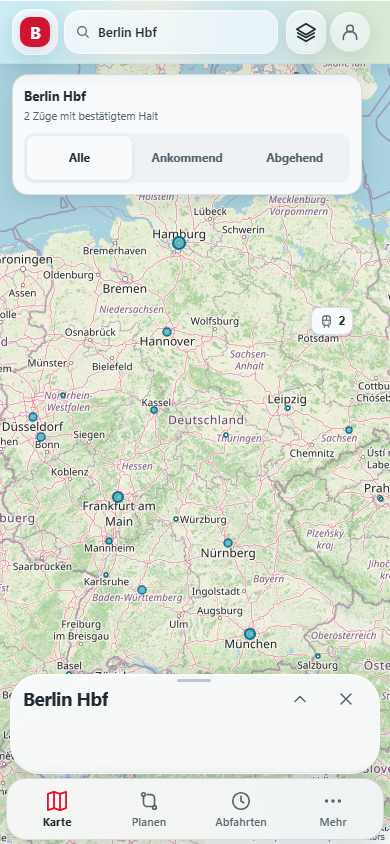
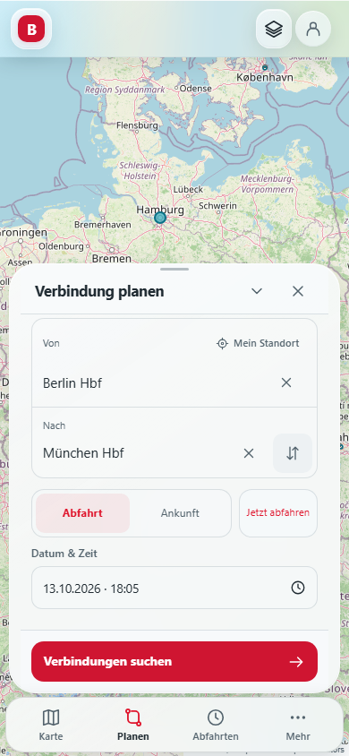
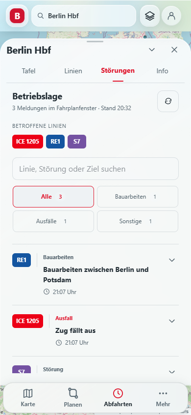
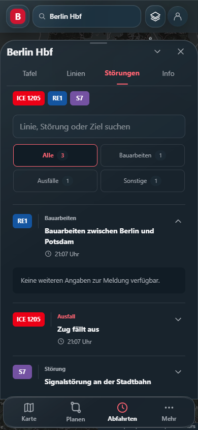
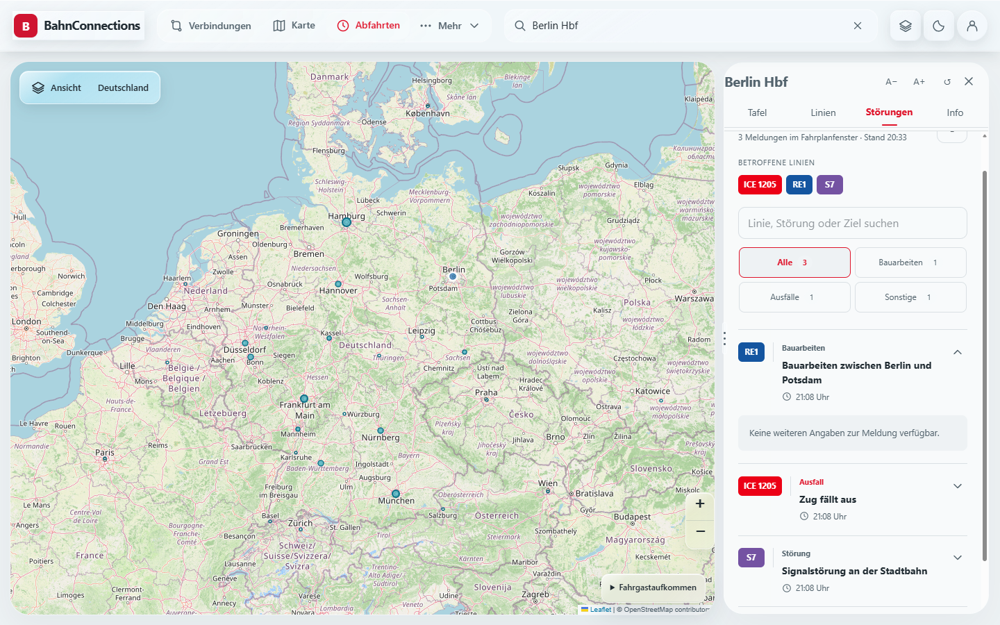

# Bahnhofsradar und mobile Zugansicht – Rework-Bericht

Stand: 13. Oktober 2026. Ausgangspunkt: V56.2 auf `main`, Commit `b9abd32`. Rework-Branch: `feat/v57-mobile-station-radar`. Dieser Bericht beschreibt den neuen Quellstand; er ist keine Bestätigung einer Veröffentlichung auf Sites oder Render.

## Was sich für Fahrgäste ändert

Die Zugansicht beginnt mit dem tatsächlichen Start- und Zielbahnhof der gesamten Fahrt. Darunter stehen der nächste Halt und die Ankunft am Ziel. Der vollständige Haltverlauf ist eine durchgehend scrollbare Liste: keine Begrenzung auf sechs Halte, kein zusätzlicher Schalter zum Freigeben weiterer Halte. Lange Stationsnamen dürfen umbrechen, Zeitangaben behalten ihren Platz. Der Kopf mit Schließen und Vergrößern bleibt außerhalb des scrollenden Inhalts.

Das bisherige große Cockpit hat dieselben Angaben mehrfach dargestellt und den aktuellen Streckenabschnitt als Hauptverbindung gezeigt. Die neue Ansicht entfernt diese Wiederholungen, die große Geschwindigkeitszahl und die zusätzliche Kompasskarte. Modellgeschwindigkeit, Positionsqualität und Datenstand sind unter „Position & Datenquelle“ zugänglich. Die Ankunft am Ziel wird aus dem letzten Halt der Fahrt gelesen, nicht aus dem nächsten Radarabschnitt.

Auf der Karte gibt es einen Richtungspfeil vor dem Zug. Das zusätzliche dreieckige Symbol in der Mitte entfällt. Wenn keine Richtung ermittelt werden kann, wird kein erfundener Richtungspfeil gezeigt. Die Position bleibt eine Schätzung anhand der gelieferten Strecke und Haltezeiten, keine GPS-Ortung. Die vorhandene sanfte Markerbewegung bleibt auf plausible, zusammenhängende Positionsänderungen begrenzt; reduzierte Animationen werden berücksichtigt.

„Alle“, „Ankommend“ und „Abgehend“ beziehen sich auf den ausgewählten Bahnhof. „Alle“ bedeutet alle bestätigten Bahnhofshalte innerhalb des aktuellen Radarangebots, einschließlich ankommender und bereits abgefahrener Fahrten. Es bedeutet nicht alle Züge Deutschlands. Zugart und Verspätungsfilter können zusätzlich eingeschränkt werden. Die Karte gleicht exakte Fahrt-IDs mit Ankunfts- und Abfahrtstafel dieses Bahnhofs ab. Eine ähnliche Linienbezeichnung oder räumliche Nähe allein reicht nicht mehr aus.

## Gefundene Fehler und Korrekturen

| Fehler | Nachweis und Korrektur |
| --- | --- |
| Ein S2 zwischen Humboldthain und Nordbahnhof erschien beim Bahnhof Berlin Hbf, obwohl kein Halt bestätigt war. | Der neue UI-Test scheiterte vor der Änderung an genau dieser Fahrt. Der Radarfilter verwendet jetzt die Fahrt-IDs der Bahnhofstafeln. Nicht bestätigte oder ausgefallene Halte werden ausgeschlossen. |
| Der Zugkopf zeigte nur den aktuellen Abschnitt statt der gesamten Fahrt. | Ein Testzug mit neun Halten zeigt Hamburg Hbf → München Hbf. Zusätzlich wurde live der ICE 379 Berlin Hbf → Karlsruhe Hbf mit acht Halten im Browser geöffnet. |
| Lange Fahrtverläufe verloren ihren Zielhalt nach 150 Einträgen. | Ein Datentest mit 153 Halten bewahrt jetzt den letzten Halt. |
| Derselbe Bahnhof erschien zweimal an einem Abschnittsübergang mit Aufenthaltszeit. | Ankunft und Abfahrt werden zu einem Halt zusammengeführt; Gleis und beide Zeiten bleiben erhalten. |
| Fehler beim Aktualisieren konnten alte Angaben weiter als aktuelle Prognose darstellen. | Der letzte Verlauf bleibt lesbar, Echtzeitfarben werden neutralisiert, ein erneuter Abruf ist möglich. Der Fehler- und Wiederherstellungsweg ist im Browser mit HTTP 502 geprüft. |
| Beim Schließen konnten Auswahl und Verfolgungszustand zurückbleiben. | X setzt Zugauswahl, Verfolgung, Bahnhof, Fahrtgeometrie und Richtungsfilter zurück. Der UI-Test prüft, dass kein Zugpanel, Bahnhofspanel oder Verfolgungs-HUD zurückbleibt. |
| Der Wechsel vom Handyformat zum Desktop konnte eine Verbindung ohne Desktop-Seitenlayout lassen. | Der Test reproduzierte den Fehler bei 1024 Pixeln. Die Layoutzuständigkeit wird zusätzlich beim Resize aktualisiert. Der erneute Lauf erreicht die Desktopprüfungen erfolgreich. |
| Ein Zug mit mehrminütigem Bahnhofshalt konnte zwischen beiden Richtungsfiltern verschwinden. | Ein zusätzlicher Datentest reproduzierte fünf Minuten Aufenthalt. Züge am Bahnsteig gehören während des Aufenthalts zu beiden Ansichten. |

## Testumfang und Aussagekraft

Die Tests bedienen die tatsächlichen gerenderten Oberflächen in Chromium/Edge. Kontrollierte Fahrplanantworten machen Ausfälle, +11 Minuten, lange Namen und Richtungszuordnung reproduzierbar. Sie beweisen die UI- und Verarbeitungslogik; sie beweisen keine flächendeckende Qualität des externen Fahrplananbieters. Die Liveprüfung mit dem ICE 379 ergänzt diese kontrollierten Fälle.

| Bereich | Prüfung |
| --- | --- |
| Neues Bahnhofsradar | Exakte Haltzuordnung; beide Richtungen; Alle zurücksetzen; fremde Fahrt ausschließen; vollständiger Verlauf; bereitgestellte Strecke auf Karte; Abruffehler, Retry; Verfolgung und X. |
| Neue Zugansicht | 320×640, 360×780, 390×430, 430×932, 768×1024 und 1440×900; keine horizontal überstehenden Panelinhalte. |
| Planung | 46 Interaktionsfälle, einschließlich Suchauswahl, kurzer Bildschirmhöhe, Optionen, Datumswahl, Zurücknavigation und Wechsel zwischen Handy und Desktop. |
| Zeit- und Farblogik | Pünktlich, früher, kleine Verspätungen, +11 bis +45, Ausfall, unbekannte Zeiten, veraltete Prognosen, Gleisänderung und Zeitzonenwechsel. |
| Fahrtdaten | Zusammenführung gemeinsamer Abschnittsgrenzen; 153 Halte; ungültige IDs und Zeiten; ausgefallene Bahnhofshalte. |
| Bestehende Funktionen | Gemeinsame Audits für Fahrplan, Tafeln, Linienfarben, Kalenderdateien, gespeicherte Routen, Kartenlebenszyklus, Eingabevalidierung, Produktoberflächen und geschlossene nicht konfigurierte Bezahlfunktionen. |

Die alten Quelltextprüfungen auf Cockpit-Klassennamen wurden durch Tests der sichtbaren neuen Bedienabläufe ersetzt. Die neuen Fahrt- und Bahnhofsradartests sind Teil des GitHub-Qualitätsworkflows. Das verhindert, dass eine spätere Änderung wieder nur die veralteten CSS-Namen erfüllt, während das eigentliche Produktverhalten kaputtgeht.

Der breite Browserlauf hat 120 Kombinationen aus Format, Thema und Ansicht, 24 Echtzeitszenarien, acht Profil-/Einstellungs-/Routenfälle, 49 weitere Layoutaufnahmen und vier Websiteprüfungen erfolgreich abgeschlossen. Der ergänzende Radar-Stresstest hält 180 Marker mit je 6.000 Geometriepunkten bei vierfach verlangsamter CPU stabil: kein Austausch der Marker beim Tick, längste gemessene Hauptthread-Aufgabe 57 ms. TypeScript, Produktionsbuild und 16 Daten-/Quellstandaudits waren erfolgreich; Lint meldet zwei bereits vorhandene Hinweise zur Bildoptimierung und keine Fehler.

Im Windows-Test musste der Headless-Browser vor Pollingprüfungen ausdrücklich in den Vordergrund gesetzt werden. Eine verdeckte Seite pausiert ihre Abrufe absichtlich. Diese Korrektur am Testaufbau darf nicht als produktiver Fahrplanfehler ausgegeben werden.

## Grenzen, die sichtbar bleiben müssen

Die Karte bekommt nur die Fahrten, die der Radaranbieter für die aktuelle Umgebung liefert. Der Abgleich kann keine fehlende Fahrt erzeugen. Die Bahnhofstafeln werden getrennt aktualisiert. Wenn die Haltprüfung fehlschlägt, werden unbestätigte Züge ausgeblendet und der Fehler angezeigt. Die Zahl ist daher keine Garantie für jeden tatsächlich fahrenden Zug.

Wenn der Anbieter keinen vollständigen Verlauf liefert, bezeichnet die Oberfläche ihre vorhandenen Daten ausdrücklich als Abschnitt. Wenn keine belastbare Streckengeometrie vorliegt, gibt es keine frei erfundene Verbindungslinie und keinen Schalter für eine angeblich vollständige Kartenstrecke. Fehlende Zeiten werden nicht durch die Ankunft am nächsten Halt ersetzt.

Die kleinen Bildschirmhöhen simulieren den Platzverlust durch eine Tastatur. Das ersetzt keinen Test auf echter Android- oder iOS-Hardware mit deren Browser, Tastatur und Safe Area. Ebenso ersetzen die Kalenderausschnitt- und ICS-Tests keine bestätigte Speicherung in einem persönlichen Google-/Apple-/Outlook-Konto. Bezahlvorgänge und persönliche Standortfreigaben sind nicht als echte Transaktion durchgeführt worden.

## Nächste sinnvolle Erweiterungen

1. **Reise beobachten:** Ein gespeicherter Zug mit sichtbarem Datenstand, Gleisänderungen und Hinweisen bei Ausfall; Pushmeldungen erst mit zuverlässigem Backend und klarer Einwilligung.
2. **Umstieg absichern:** Tatsächliche Umsteigezeit, Ankunftsgleis, Abfahrtsgleis und eine nachvollziehbare Warnung, wenn der Anschluss gefährdet ist. Keine frei geschätzte Gehzeit ohne Stationsdaten.
3. **Offline-Reiseübersicht:** Letzte gespeicherte Verbindung und ihre Halte verfügbar halten, ausdrücklich mit altem Datenstand. Offlinewerte dürfen keine grünen Echtzeitversprechen bekommen.
4. **Geräteprüfung:** Die wichtigsten Wege auf realen Android- und iOS-Geräten mit eingeblendeter Tastatur, großer Schrift, Screenreader und Hoch-/Querformat testen.
5. **Gezielte Animationen:** Kurze Rückmeldung bei Richtungswechsel und beim Öffnen einer Fahrt; ruhiges Hervorheben des nächsten Halts. Keine dauernden Pulse, Kamerafahrten oder Blur-Animationen, die Bedienung und Akkulaufzeit belasten.

Die gestalterische Orientierung ist eine klare Trennung zwischen Kartenbeobachtung und Reisekette. Als Referenzen dienten die [digitale Reisebegleitung der DB](https://www.bahn.de/service/fahrplaene/digitale-reisebegleitung) und die [Such- und Filterübersicht von Flightradar24](https://www.flightradar24.com/blog/inside-flightradar24/new-flightradar24-search/). Die Umsetzung übernimmt keine fremden Markenbestandteile.

## Gestaltungsnachbesserung vom 13.10.2026

Die gemeldeten „1 ZÜGE“-Kreise und das zusammengedrängte Startfeld sind überarbeitet. Einzelzüge bleiben auch bei kleinem Zoom Einzelzüge; nahe Positionen werden anhand ihres Bildschirmabstands in benachbarten Rasterzellen zusammengefasst. Gruppen tragen nur ein Bahnsymbol und die Anzahl. Ein ruhiger Hintergrund ersetzt die großflächige Statusfarbe. Einzelmarker haben ein eigenes SVG-Bahnsymbol, einen einzigen vorderen Richtungspfeil und eine 44 × 44 px große Bedienfläche. Ihre Grundfarbe unterscheidet Fernverkehr, Regionalverkehr, S-Bahn, U-Bahn und Tram; verspätete Fahrten erhalten zusätzlich einen gelben beziehungsweise roten Rand. Die Prognosefarben in den Zeiten bleiben erhalten.

„Mein Standort“ steht mit der Beschriftung oberhalb des Startfelds. Der Bahnhof bekommt eine eigene volle Eingabezeile. Das Tauschen besitzt eine eigene Fläche neben dem Zielfeld. Ab 360 px stehen die Zeitwahl und „Jetzt abfahren“ nebeneinander, damit Datum und Uhrzeit in der normalen mobilen Ansicht sichtbar bleiben. Bei wenig Platz kann der Formularinhalt weiterhin scrollen, während die Suche erreichbar bleibt.

Referenzen: [Flightradar24 Kartenbeschriftungen](https://www.flightradar24.com/blog/inside-flightradar24/new-flightradar24-com-label-options/) und [DB Navigator Verbindungssuche](https://www.bahn.de/service/mobile/db-navigator/verbindungssuche). Die Trennung zwischen Symbol, Beschriftung und Detailansicht ist unsere eigene Gestaltungsentscheidung.

Erneut erfolgreich geprüft: TypeScript, Lint (zwei bestehende Bildhinweise), Produktionsbuild, Map-/Radar-Audits, 46 Planungsprüfungen über 13 Bildschirmgrößen und beide Farbschemata, Bahnhofsradar einschließlich Gruppierung/Zoom/Filter/Retry/Schließen und sechs Größen sowie Radar-Stresstest mit 180 stabilen Markern ohne DOM-Austausch. Ergänzte Regressionen prüfen die getrennten Flächen von Standortaktion und Startfeld sowie echte Mehrzuggruppen. Der vorherige GitHub-Qualitätslauf für 671c846 war erfolgreich; die Nachbesserung bekommt einen neuen Lauf. Keine Prüfung auf physischer Smartphone-Hardware.

Kontrollierte Testdaten, lokale Vorschau:

## Weitere Korrekturen: Störungsbezug und Mexikoplatz

Der Störungsfeed übernimmt nur nachweislich betriebliche Einschränkungen oder Ausfälle. Allgemeine Informationen und ausdrücklich wirkungslose Meldungen erzeugen keine betroffenen Linien. Strukturierte Anbieterwirkungen werden berücksichtigt. Gemeinsame Hinweise behalten alle betroffenen Linien; eine unterschiedliche Fahrt, Richtung oder Zeit wird nicht der ersten Fahrt entnommen und pauschal auf andere Linien übertragen. Die bisherige Begrenzung auf neun Linien beziehungsweise 35 Meldungen wurde entfernt.

Die Bahnhofssuche erkennt denselben vollständigen Namen bei vorangestelltem oder nachgestelltem Ortsnamen. Live überprüft: „Berlin Mexikoplatz“ wird als „S Mexikoplatz (Berlin)“ gemeldet, de-VBB_de:11000:900050301. Die geografische Schranke und die Ablehnung mehrdeutiger Treffer bleiben bestehen. Statistik, Verfolgung und Verfügbarkeit einer Zugauswahl nutzen nun dieselbe geprüfte Menge von Bahnhofshalten wie die Karte.

Validierung: 16 Audits erfolgreich, TypeScript und Produktionsbuild erfolgreich, Bahnhofsradar-Regressionsprüfung erfolgreich, Bahnhofsblatt mit Störungsfilter/Suche in 390 px und beiden Farbschemata erfolgreich. Neue Fälle: umgestellter Ortsname, fremder/weit entfernter Bahnhof, reine Information, ausdrücklich keine Störung, strukturierte Umleitung und zwölf gemeinsam betroffene Linien. Ein veralteter Quelltexttest erwartete die früheren 40-px-Marker und blockierte den vorigen CI-Lauf; er prüft jetzt die vorhandene 44-px-Bedienfläche.

## 12ui-Entwurf A integriert

Variante A wurde nach der ausdrücklichen Kostenfreigabe als LayerDoc und responsives HTML exportiert. Der Störungs-Tab verwendet seine flache Listenstruktur: Linienkennzeichen, Trennlinien, Meldungsart, Überschrift, Zeitpunkt und ein Chevron zum Öffnen der hellen Detailfläche. Alle betroffenen Linien erscheinen direkt oberhalb der Liste; Meldungen ohne betriebliche Einschränkung erzeugen kein Kennzeichen. Die Farben kommen aus derselben Verkehrsmittel-/Linienpalette wie Tafel und Karte. Der Bahnhof wird nicht in jeder Meldung wiederholt. Datenherkunft und Aktualisierungsdetails sind als gesonderte Offenlegung erreichbar, Fehler und Teilansichten bleiben sofort sichtbar.

Der Export dient als Layoutgrundlage für echte React-Daten, nicht als fertige Fahrplantafel. Seine festen Koordinaten und Höhen wurden in normale Grid-/Flex-Flüsse übertragen, damit lange Meldungen und unterschiedliche Linienzahlen Platz bekommen. Die vorhandenen funktionierenden Bahnhofstabs und Navigation übernehmen die entsprechenden Teile des Entwurfs. Das ausgeschnittene Routen-Icon wird als echtes, 11-KB großes Asset in der mobilen Navigation verwendet; die übrigen Iconrollen nutzen die vorhandenen zugänglichen SVGs. Die Ausgangs-Token-Datei enthält keine wiederkehrenden Änderungen. Systemschrift und Hell-/Dunkel-Themen bleiben erhalten; es wird keine zusätzliche Google-Schrift geladen. Einzelne Datum-, Fahrt- und Linienbeispiele aus dem Bild sind ausschließlich Referenzinhalt und werden durch Anbieterwerte ersetzt.

Längere übersetzte Anbietertexte bleiben bis 6.000 Zeichen erhalten; vorher wurden bereits nach 360 Zeichen wichtige Angaben abgeschnitten. Details lassen sich mit dem nativen Details/summary-Element öffnen und schließen. Kategorien besitzen mindestens 44 px hohe, gleichmäßig angeordnete Bedienflächen. Der wiederholte Gesamtzähler entfällt ohne aktive Filter; bei einer Suche bleibt die Trefferzahl sichtbar.

Validierung: neun Größen von 320 bis 1.920 px, jeweils hell und dunkel, mit kontrollierten Abfahrts-/Ankunftsmeldungen. Geprüft wurden nur betroffene Linien, Suche, Kategorien, Details öffnen/schließen, getrennte Text-/Badge-/Chevron-Spalten und horizontale Überläufe. Keine Überlappung in diesen Fällen. Der Bahnhofsradar-Regressionslauf bestätigt weiter Bahnhofshalte, genau einen Frontpfeil und vollständiges Beenden der Verfolgung. TypeScript, Produktionsbuild, Daten-/Transport-/Karten-/Routen-/Planer-Audits waren erfolgreich; Lint hat keine Fehler und zwei bestehende Bildhinweise. Der GitHub-Qualitätslauf für c477cde war erfolgreich. Ein neuer Lauf folgt für diesen Entwurf.

Der erlaubte kostenlose Abschlussvergleich nutzt den unveränderten ursprünglichen LayerDoc und eine eingefrorene anonyme DOM-Aufnahme der tatsächlichen Browserdarstellung mit Testmeldungen. Das Einfrieren vermeidet einen Timeout durch laufende Karten-/Fahrplanabrufe. Die Aufnahme enthält die geladenen CSS-Regeln; eine anfängliche ungestaltete Aufnahme wurde verworfen. Das vollständige Kit liegt unter work/12ui-station-disruptions-final-alignment. Seine Zuordnung ist mit 27,7 % DOM- und 35,3 % Designüberdeckung schwach: Der Entwurf ist 1.536 px breit, die Aufnahme 390 px und enthält zusätzliche benötigte Suche und Kategorien. Die vorgeschlagenen auf 5–8 px skalierten Schriftgrößen und falschen Zuordnungen von Linienkennzeichen zu Uhrzeiten werden deshalb nicht übernommen. Die tatsächlichen mobilen und Desktopaufnahmen werden direkt mit Variante A verglichen; dies ist keine Behauptung einer pixelgleichen Umsetzung oder eines bestandenen 60-%-Abgleichs. Aus dem Vergleich übernommen: ruhige Trennung, helle Detailflächen, weniger wiederholte Angaben und eine gleichmäßige Filteranordnung.

### 12ui-Kostenprotokoll

| purchase | stage | invocation | price ceiling |
| --- | --- | --- | --- |
| `crt-3dc0e197ea80102d13f0a18942ecdc1e3c67131f` | draft | `improve` pid 8924, started 2026-10-13T18:03:24.491Z | $0.12 (stage ceiling) |
| `b96f093b-ac60-4ab5-9e99-c1c71573a088` | convert | `improve` pid 38132, started 2026-10-13T18:10:10.956Z | $0.55 (stage ceiling, shared by 2 purchases) |
| `ce7aa450-44e5-437f-bc8c-0c98b844061c` | convert | `improve` pid 38132, started 2026-10-13T18:10:10.956Z | $0.55 (stage ceiling, shared by 2 purchases) |

Die Exportobergrenze 0,55 USD gilt zusammen für beide Convert-Einträge. Zusammen mit dem vorherigen Entwurf beträgt die protokollierte Gesamtobergrenze gerundet 0,67 USD; die tatsächliche Rechnung wird serverseitig abgerechnet. Die Abschlusskits haben keine Käufe. Designkits und Referenzbilder bleiben lokal ignoriert.

Kontrollierte Testmeldungen, lokale Implementierung:

