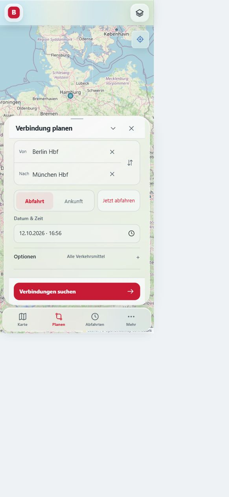
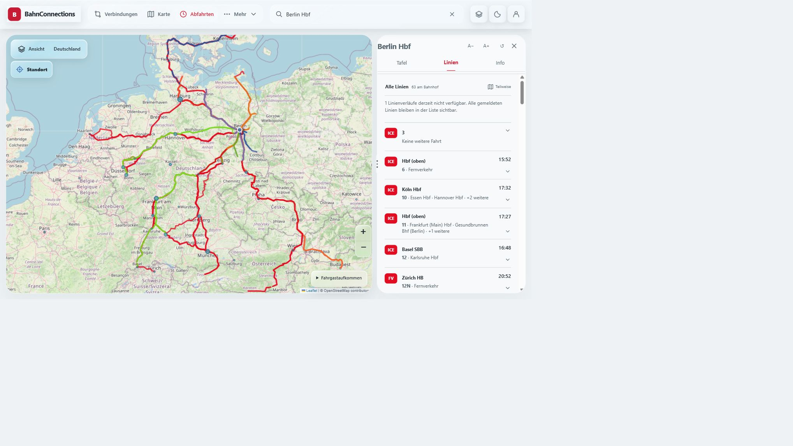

# BahnConnections: Reifeprüfung und Entwicklungsbericht

Stand: 12. Oktober 2026. Untersuchte öffentliche Anwendung: https://bahnconnections-v55.onrender.com/. Quellstand der Ausgangsversion: `b7fdf758740c5edab058b6a96f57c9f43bba6a82` auf `Cola968/BahnConnections`. Die hier beschriebenen Änderungen bereiten V55.1 vor. Ein erfolgreicher lokaler Test bedeutet noch keine Veröffentlichung auf Render.

## 1. Gesamtbeurteilung

BahnConnections besitzt bereits einen brauchbaren Funktionskern: Bahnhofssuche, Verbindungsplanung, Abfahrt und Ankunft, Linien, Fahrtverläufe, Kartenansichten, Zugradar sowie lokale Favoriten und Pendelstrecken. Das ist mehr als eine reine Demonstration. Für eine im Alltag verlässliche Reise-App reicht der jetzige Stand dennoch nicht aus. Die wichtigsten Lücken liegen bei stabiler Bedienung unter schwierigen Bildschirmbedingungen, nachvollziehbaren Datenzuständen und dem Nachweis, dass die Kernfunktionen auch bei Ausfällen funktionieren.

Eine reife App muss drei Fragen verlässlich beantworten: Welche Verbindung kann ich nehmen? Welche Information ist aktuell und wie sicher ist sie? Wie komme ich nach einem Fehler oder einer versehentlichen Aktion wieder weiter? Animationen können diese Antworten unterstützen. Sie können fehlende Datenqualität und verdeckte Schaltflächen jedoch nicht ausgleichen.

Diese Bewertung ist eine technische und praktische Einschätzung aus Bedienung und Codeprüfung. Sie ist kein vollständiger Sicherheitsnachweis und keine Zertifizierung für sämtliche Geräte oder Datenquellen. Es gibt ausdrücklich noch offene Freigabekriterien.

## 2. Testmethode und Grenzen

Die öffentliche V55 wurde im Browser tatsächlich bedient. Es wurden Suche, Planung, Tafel, Linien, Fahrtdetails, Radar, Favoriten, Pendelstrecken, Einstellungen, Hilfe und Installation untersucht. Frühere Testläufe dieser Prüfung verwendeten Größenvorgaben von 320×568, 390×844, 390×360, 844×390, 1024×768, 1366×768 und 1440×900. Nicht jede Funktion wurde bei jeder Größe geprüft. Die Screenshots und der detaillierte erste Testbericht liegen im separaten lokalen Audit-Verzeichnis.

Für die korrigierte Version wurde zusätzlich eine isolierte lokale Anwendung gestartet. Browserzoom kann Größenvorgaben verfälschen. Deshalb wurden die tatsächlichen CSS-Maße über die sichtbare DOM-Geometrie kontrolliert. Bestätigt wurden unter anderem 390×360 für den Schließen-Test und ungefähr 1365×768 für die Desktop-Linienliste. Die sehr schmale Linienprüfung lief effektiv bei 358×569: Der Browser begrenzte den kleineren Größenoverride. Das ist kein Nachweis für einen erneuten Test der korrigierten Version bei exakt 320 Pixeln.

Ein Fenster mit geringer Höhe simuliert Platzmangel, aber keine echte Bildschirmtastatur. Android Chrome und iOS Safari, Berechtigungen für GPS, installierte PWA, Browserleisten, große Systemschrift und Bedienung mit Screenreader müssen auf echten Geräten zusätzlich geprüft werden. GitHub Desktop war im vorangegangenen Fensterinventar nicht geöffnet. GitHub-Code und Änderungen werden deshalb mit dem GitHub-Connector und Git geprüft; eine Bedienung von GitHub Desktop wird nicht als durchgeführt ausgegeben.

## 3. Was bereits funktioniert

Die Planung Berlin–München lieferte im Test mehrere Alternativen. Start und Ziel konnten getauscht werden. Die Stationstafel konnte zwischen Abfahrt und Ankunft wechseln und bot Filter für Verkehrsmittel und Verspätung. Ausfälle waren kenntlich. In den untersuchten Ansichten wurden stärkere Verspätungen rot angezeigt, beispielsweise +11 beziehungsweise +45 Minuten; kleinere Abweichungen erschienen in einem Warnfarbton. Die gemeinsame Echtzeitlogik unterscheidet unbekannte Werte vom Fahrplan.

Berlin Hbf zeigte 63 gemeldete Linien unmittelbar in einer durchgehenden Liste. Es war keine vorherige Filterauswahl oder Listenpagination notwendig. Ein nicht abrufbarer Kartenverlauf wurde als teilweise verfügbare Linienkarte kenntlich, ohne die zugehörige Linie aus der Liste zu entfernen. Das entspricht der gewünschten Trennung zwischen sichtbaren Linien und optional verfügbarer Geometrie.

Favoriten und lokale Pendelstrecken ließen sich speichern und entfernen. Der Rückweg einer Pendelstrecke ließ sich aufrufen. Dunkles Erscheinungsbild, größere Schrift und reduzierte Animation konnten eingestellt werden. Die Plus-Ansicht machte deutlich, dass das Angebot noch nicht buchbar ist. Diese Funktionen bilden eine gute Grundlage, müssen aber auch bei beschädigtem Speicher, Updates und Gerätewechsel verlässlich erklärt werden.

## 4. Bestätigte Bedienungsfehler und Änderungen für V55.1

| Problem | Beobachtung | Änderung | Nachweis und verbleibende Grenze |
|---|---|---|---|
| Suche verdeckt Panel-Kopf | Bei kurzer mobiler Höhe überlappt die allgemeine Suche den Planer; X öffnet die Suche | Allgemeine Suche bei geöffnetem Hauptpanel und kurzer Höhe ausblenden | Effektiv 390×360: Hit-Test trifft X; Klick schließt den Planer |
| Desktop-Linien sind schlecht lesbar | Zielbeschreibung bekommt nur 52 px, Zeitbereich nimmt die flexible Spalte ein | Explizite Symbol-/Text-/Zeitspalten über benannte Klassen | Etwa 1365×768: Text ca. 236 px, Uhrzeit ca. 32 px; keine Überlappung dieser Spalten |
| Fernverkehrslinien unklar | Generisches ICE-Symbol und Ziel, Linienkennung teilweise nur im zugänglichen Namen | Vorhandene Fernverkehrskennung zusätzlich sichtbar | Im DOM und Screenshot sind z. B. 6, 10, 11 und FLX10 sichtbar |
| Schließen lässt Reiseoptionen stehen | Reset setzt Karte/Route zurück, aber nicht Reisezeit und Filter | Zeit, Ankunftsmodus, Umstiege, Puffer, Fahrrad, Barriereoption und Kategorien zurücksetzen | UI-Test mit Direktverbindung, 12 Minuten Puffer, Fahrrad und abgewählter S-Bahn; danach Standards wieder aktiv |
| Zwei widersprüchliche Geschwindigkeiten | ICE 557 zeigt gleichzeitig Modell 107 km/h und Abschnittsmittel 349 km/h | Redundante Abschnittsgeschwindigkeit aus Inspector entfernen | Codeprüfung und Build; einzelne Modellgeschwindigkeit bleibt ausdrücklich Schätzung |
| Alte Ankunft wirkt bestätigt | Vergangener Fahrplanwert wird zu 0 Minuten und „Ankunftszeit erreicht“ | Restzeit nur bei aktueller Quelle und nicht abgelaufenem Zeitpunkt; keine Ankunftsbestätigung aus Zeit allein | Grenzfalltest für veraltete, vergangene, ungültige und zukünftige Zeiten |
| Datum im Desktop zu eng | Datum und Zeit konkurrieren mit Abfahrt/Ankunft um eine schmale Zeile | Datum erhält eine vollständige Zeile | Lokales Layout geprüft; erneuter kompletter Gerätevergleich bleibt erforderlich |

Das Linienproblem entstand durch konkurrierende historische CSS-Regeln für `span:last-child`. Eine erste lokale Korrektur wurde durch die höhere Spezifität dieser Regel überstimmt. Die Messung machte das sichtbar; die endgültigen Selektoren berücksichtigen diese Priorität. Das zeigt, warum reine Quelltextprüfungen keinen visuellen Test ersetzen.

## 5. Bereits hinzugefügt: „Jetzt abfahren“

Der Planer erhält eine direkte Aktion „Jetzt abfahren“. Sie setzt Datum und Uhrzeit auf die aktuelle Berliner Ortszeit und schaltet vom Ankunfts- zum Abfahrtsmodus. Die bestehenden Anforderungen an Umstiege oder Fahrrad bleiben dabei erhalten; nur ein vollständiges Schließen setzt die ganze Reise zurück. Dadurch bleibt die Aktion vorhersehbar.

Der Bedienungstest bestätigte den Wechsel aus „Ankunft“ zu „Abfahrt“ und die aktuelle Uhrzeit. Die Schaltfläche hat eine verständliche zugängliche Bezeichnung und eine Mindesthöhe von 44 Pixeln. Bei schmalen Fenstern werden die Zeitaktionen untereinander angeordnet, damit lange Beschriftungen nicht zusammengeschoben werden.

Die Versionsdatei, Update-Adresse, der Service-Worker-Cache und das Changelog sind für V55.1 synchronisiert. Der neue Countdown-Grenzfalltest ist in die bestehende Qualitäts-CI aufgenommen. Die Versionierung bereitet ein konsistentes Update vor; sie bestätigt keine bereits erfolgte Produktionsauslieferung.

## 6. Datenqualität: die wichtigste noch offene Baustelle

Die Linienliste enthält gleichzeitig Bezeichnungen wie „FlixTrain FLX10“ und „FLX10“. Ziele erscheinen in Varianten wie „Wismar Bahnhof“ und „Wismar, Bahnhof“ oder „Stralsund Hauptbahnhof“ und „Stralsund, Hauptbahnhof“. Im früheren Tafeltest gab es ähnlich wirkende RE8-Einträge mit gleicher Sollzeit und leicht unterschiedlichen Zielnamen. Das ist ein konkreter Hinweis auf Normalisierungsbedarf. Es beweist noch nicht, dass jedes ähnliche Paar dieselbe Fahrt ist.

Die App sollte Fahrten anhand stabiler Quellen-ID, Datum, Sollzeit, Bahnhof und Betreiber zuordnen. Nur nachweislich identische Fahrten dürfen zusammengeführt werden. Unterschiedliche Fahrten mit gleichem Namen dürfen nicht verschwinden. Namensnormalisierung für die Anzeige und Identitätsvergleich müssen getrennt bleiben. Eine automatische Zusammenführung nur nach Text wäre riskant und wurde hier bewusst nicht eingebaut.

Fernverkehrskennungen wie 10 oder 11 sind außerdem nicht automatisch Zugnummern einer konkreten Fahrt. Die Oberfläche sollte zwischen Verkehrsprodukt, Netzlinie und individueller Zugnummer unterscheiden. Auch generische Einträge wie „Linie“ und Ziele wie „Hauptbahnhof (oben)“ brauchen Kontext. „Alle Linien“ sollte fachlich „alle von der Quelle gemeldeten Linien im betrachteten Zeitfenster“ bedeuten; vollständige heutige Netzdaten sind damit nicht garantiert.

Für Prognosen sollte jede Ansicht dieselben Regeln verwenden: Quelle, Alter, Echtzeit vorhanden, Vergleich zum Fahrplan möglich und Geometrie verfügbar. Eine fehlende Prognose darf nie als Pünktlichkeit interpretiert werden. Auch eine abgelaufene Uhrzeit beweist keine tatsächliche Ankunft. Der jetzt korrigierte Countdown ist ein Schritt in diese Richtung.

## 7. Zuverlässigkeit unter schlechten Netzbedingungen

Die Planung zeigte zeitweise Warnungen zur nicht erreichbaren Gegenprüfung; bei einem anderen Versuch war die Suche nicht erreichbar. Fehlerzustände und eine erneute Suche sind vorhanden. Für den Alltag muss jedoch konsequent unterschieden werden zwischen „keine Verbindung erfüllt deine Filter“, „Dienst antwortet nicht“, „Teildaten verfügbar“ und „Verbindung existiert, Echtzeit fehlt“.

Jeder externe Aufruf braucht eine begrenzte Laufzeit. Wenn ein Nutzer die Ansicht schließt oder das Ziel wechselt, soll die alte Antwort keine neue Ansicht überschreiben. Die Client-Seite verwendet an mehreren Stellen Abbruchsteuerung. Im untersuchten `/api/journeys`-Handler wird der Request-Abbruch allerdings nicht an `fetchLiveJourneysDirect` weitergegeben. Die Stationssuche ruft die Quelle ohne explizites Timeout in diesem Handler auf. Diese Unterschiede sollten vereinheitlicht und mit echten Abbruch- und Ausfalltests geprüft werden.

Wiederholte Anfragen brauchen kurze Zwischenspeicherung, begrenzte Parallelität und eine nachvollziehbare Wiederholungsstrategie. Ein Fehler darf keinen dauerhaften leeren Zustand vergiften. Bereits vorhandene Tests für abgebrochene Stationsauflösung und beschädigte lokale Einstellungen sind hilfreich. Zusätzlich braucht es Tests für mehrere schnelle Stationswechsel und eine unterbrochene Verbindung während der Reise.

## 8. Bedienungs- und Designsystem konsolidieren

Das Projekt importiert zahlreiche historische Stylesheets, unter anderem v49, v52, v53, v54 und v55. Die belegte Spaltenkollision zeigt eine konkrete Folge: eine ältere positionsabhängige Regel kann eine neuere Komponente unbemerkt verändern. Die kurzfristige Reparatur ist bewusst klein. Mittelfristig sollten Regeln pro Komponente gebündelt und veraltete Überschreibungen mit visuellen Vergleichstests entfernt werden.

Für Panels sollte es einen klaren Vertrag geben: fester Kopf, genau ein Inhaltsbereich zum Scrollen, erreichbare Schließen-Aktion, definierte Mindesthöhe und abgesicherter Platz für Navigation und Tastatur. Auf dem Desktop zählt die tatsächliche Breite der Seitenleiste, nicht nur die Fensterbreite. Lange Bahnhofsnamen, 200 Prozent Textvergrößerung und übersetzte Beschriftungen dürfen diese Regeln nicht brechen.

Information sollte nach Bedeutung gewichtet werden: Zug/Linie, Ziel, Zeit, Abweichung und Gleis zuerst; Quellen- und Hintergrunddetails danach erreichbar. Kompakter darf nicht heißen, dass Abweichungen oder Anschlussrisiken verschwinden. Alle Linien bleiben als Liste verfügbar, während Fahrtdetails bei Bedarf geöffnet werden dürfen.

## 9. Barrierefreiheit und echte Geräte

Vor einer breiten Freigabe sind vollständige Tastaturabläufe erforderlich: Suche öffnen, Treffer wählen, planen, Alternative wählen, Dialog schließen und zum auslösenden Element zurückkehren. Fokus muss sichtbar sein und darf beim Live-Update nicht springen. Statusmeldungen sollten verständlich angekündigt werden, ohne jede kleine Radaränderung vorzulesen.

Verspätungen brauchen immer Text oder ein Symbol zusätzlich zur Farbe. Warnfarben müssen bei heller und dunkler Oberfläche lesbar bleiben. Transparenz, hohe Kontraste, reduzierte Bewegung, große Schrift und langsame Geräte gehören in dieselbe Testmatrix. Das gilt besonders für Glasflächen vor wechselnden Kartenausschnitten.

Für echte Smartphones fehlen in dieser Prüfung insbesondere Tastatur öffnen/schließen, Querformatwechsel bei offener Suche, Rücktaste, Safe Areas, dynamische Browserleisten und native Datumsauswahl. GPS-Verweigerung und spätere Freigabe müssen verständliche Zustände erzeugen. Eine gespeicherte PWA braucht dieselben Tests unabhängig vom normalen Browser.

## 10. Betrieb und reproduzierbare Releases

Der geprüfte `build:render`-Befehl installiert während des Builds `nitro` und `@tailwindcss/vite` ohne feste Version in diesem Befehl. Damit kann ein späterer Build andere Abhängigkeiten verwenden. Für einen reifen Betrieb sollten diese Pakete regulär festgelegt und durch den Lockfile-Installationsschritt bereitgestellt werden; der Build selbst soll keine Paketversionen auswählen. Diese Deployment-Änderung wurde hier nicht beiläufig vorgenommen, weil sie eine eigene Render-Verifikation braucht.

Die App braucht eine klar erkennbare öffentliche Hauptadresse. Die Metadaten verweisen derzeit noch auf die Sites-Adresse, während V55 auf Render untersucht wurde. Nutzer sollen über alte Links, installierte PWAs und Suchergebnisse zuverlässig die richtige aktuelle Anwendung erreichen. Hauptadresse, Metadaten und Veröffentlichungsablauf sind als gemeinsamer Arbeitsschritt zu entscheiden.

Zu einer Freigabe gehören Versionskennung, überprüfbarer Commit, Änderungsnotizen, reproduzierbarer Build, Gesundheitstest und ein geübter Rückweg zur vorherigen Version. Fehlerquote, Antwortzeiten und Datenalter sollten im Betrieb messbar sein. Ereignisse müssen ohne unnötige personenbezogene Daten protokolliert werden. Ein grüner Build allein besagt nicht, dass gerade jede Datenquelle verfügbar ist.

## 11. API- und Sicherheitsprüfung

Der Journey-Handler prüft grundlegende Felder, aber keine vollständige Laufzeitstruktur der Anfrage. Typumwandlung mit TypeScript ersetzt keine Prüfung fremder JSON-Daten. Datum, Kategorien, Koordinaten, Zeichenkettenlängen, Grenzwerte und Request-Größe sollten verbindlich validiert werden. Fehlerhafte Eingaben müssen als Eingabefehler beantwortet werden, statt im externen Aufruf zu scheitern.

Bei einer öffentlichen App sind außerdem begrenzte Anfrageraten, Schutz vor kostspieligen parallelen Abfragen und ein überprüfter Umgang mit externen URLs wichtig. Aus dieser Prüfung folgt keine Behauptung einer ausnutzbaren konkreten Sicherheitslücke. Es folgt die Aufgabe, diese Schutzmechanismen gezielt zu testen und ihre Zuständigkeit zwischen Anwendung und Hosting zu dokumentieren.

Konten und Bezahlen sollten erst angeboten werden, wenn Identität, serverseitige Berechtigungen und Wiederherstellung vollständig sind. Die vorhandene Sandbox-Abrechnung prüft bereits Konfiguration, Ursprung und Webhook-Verarbeitung. Der Render-Shim stellt jedoch keine Cloudflare-Billing-Datenbank bereit. Lokale Profile sind keine Online-Konten, und im aktuellen UI ist Plus nicht buchbar. Dies bleibt eine offene Produktstrecke, kein fertig getestetes Zahlungsangebot.

## 12. Funktionen mit hohem Alltagsnutzen

**Zuerst:** Eine angeheftete aktive Reise mit großem nächsten Umstieg, Gleis, Fußweg und Anschlussrisiko. Störungen sollten direkt an der betroffenen Fahrt stehen, mit Zeitpunkt und Quelle. Alternative Verbindungen sollen mit nachvollziehbaren Unterschieden verglichen werden: Dauer, Umstiege, Fußwege und verfügbare Prognose. Eine kurze Meldung für teilweise verfügbare Daten ist hilfreicher als zusätzliche dekorative Kennzahlen.

**Danach:** Speichern und Teilen einer Route über stabile Links; persönlicher Pendelstart ohne erneute Eingabe; gezielte Erinnerungen für Abfahrt oder Gleiswechsel, sofern eine verlässliche Daten- und Zustellungsgrundlage besteht. Benachrichtigungen brauchen verständliche Einwilligung, Abschaltung und sichtbaren Zustand. Reisedaten aus dem Offline-Speicher müssen als gespeichert mit Zeitpunkt angezeigt werden, niemals als aktuelle Echtzeitdaten.

**Später:** Geräteübergreifende Synchronisation, vollständige Online-Konten und Plus. Fahrrad, Barrierefreiheit, Aufzüge und Wageninformationen sind sinnvoll, wenn tatsächlich belastbare Quellen vorhanden sind. Ein Schalter darf keine Verfügbarkeit versprechen, die die Daten nicht belegen. Nutzer sollten sehen, was bekannt und was unbestätigt ist.

## 13. Sinnvolle Animationen

Panel öffnen und schließen: etwa 180–240 ms mit einer zurückhaltenden Positions- und Transparenzänderung. Die Animation darf den Layoutplatz nicht verändern oder eine Schaltfläche kurz unbedienbar machen. Beim Wechsel zwischen Tafel, Linien und Info kann ein kurzer Übergang Orientierung geben; Inhalt und Scrollposition sollen stabil bleiben.

Suchvorschläge können dezent eingeblendet werden. Das Eingabefeld und die Tastatur dürfen dabei nicht springen. Kartenkamera und ausgewählte Route können weich bewegt werden, solange manuelle Karteneingabe sofort Vorrang erhält. Nach einer neuen Prognose ist eine einmalige dezente Hervorhebung der geänderten Uhrzeit hilfreich.

Speichern einer Pendelstrecke braucht eine kurze Bestätigung. Dauernd pulsierende Warnungen, springende km/h-Zähler, animierte Listenumsortierung und endlose Ladeeffekte sind zu vermeiden. Bei reduzierter Bewegung müssen dieselben Abläufe ohne räumliche Animation verständlich bleiben. Animationen gehören erst nach funktionierender Geometrie und belastbarer Statuslogik in die Freigabe.

## 14. Verifikation der Änderungen

Bestanden: TypeScript-Prüfung; ESLint der geänderten Komponenten ohne Fehler; bestehende Planner-, Radar-, UI-, Transport- und Echtzeitprüfungen; neuer Countdown-Grenzfalltest; Produktionsbuild über den bestehenden Vinext/Sites-Pfad. ESLint meldet die bereits vorhandene Empfehlung zur Bildoptimierung eines Profilbildes. Dieser Bericht erklärt die Warnung nicht zu einem Funktionsfehler.

Im Browser bestätigt: Schließen bei geringer Höhe, Zurücksetzen geänderter Reiseoptionen, „Jetzt abfahren“, sichtbare Fernverkehrskennungen und korrekte Spaltenanordnung der geladenen Desktop-Linien. Die Liste enthält weiterhin alle 63 gemeldeten Linien. Ein fehlender Kartenverlauf bleibt kenntlich. Der Geschwindigkeits-/Countdown-Wechsel ist zusätzlich im Code und durch Grenzfallprüfungen abgesichert; ein kompletter erneuter Live-Radar-Durchlauf aller Quellen ist kein Bestandteil dieses Nachweises.

Die Änderungen müssen über GitHub-Checks auch in einer sauberen Linux-Umgebung bestätigt werden. Die lokale Prüfung verwendet vorhandene Abhängigkeiten. Ein Render-Produktionsbuild und die später tatsächlich ausgelieferte Version brauchen eine gesonderte Kontrolle. Screenshots belegen ausgewählte Zustände, keine universelle Fehlerfreiheit.

## 15. Priorisierter Weg zur reifen App

| Reihenfolge | Arbeit | Abnahmekriterium |
|---|---|---|
| 1 | V55.1 prüfen und ausliefern | CI erfolgreich; Render öffnet richtigen Commit; X, Planer und Linien funktionieren auf echten Smartphones |
| 2 | Datenidentität und Prognosestatus | Keine nachweislichen Dubletten; Fahrplan/Echtzeit/veraltet eindeutig; Quellenalter pro Ansicht |
| 3 | Fehler- und Abbruchabläufe | Timeout, Offline, Stationswechsel und leere Ergebnisse haben unterscheidbare, bedienbare Zustände |
| 4 | Komponenten-CSS konsolidieren | Keine widersprüchlichen Positionsregeln; visuelle Tests für schmale Panels, kurze Höhe und große Schrift |
| 5 | Betrieb absichern | Feste Build-Abhängigkeiten, eine Hauptadresse, messbare Fehler-/Antwortzeiten und getesteter Rollback |
| 6 | Reisebegleitung ergänzen | Aktive Reise, Anschlüsse, Störungen und Alternativen bleiben auch bei Teildaten verständlich |
| 7 | Konten, Synchronisation, Benachrichtigungen | Vollständige Nutzerabläufe, nachgewiesene Berechtigungen, Abschaltung, Export/Löschung und Ausfalltests |

Für die nächste Freigabe sollten die noch offenen schweren Bedienungs- und Datenprobleme zuerst abgearbeitet werden. Die bereits umgesetzten Änderungen machen die App besser bedienbar und ihre Prognosen ehrlicher. Die endgültige Reife ergibt sich aus belastbaren Alltagsabläufen, nachgewiesenen Geräteprüfungen und einem Betrieb, der Fehler schnell sichtbar und behebbar macht.
