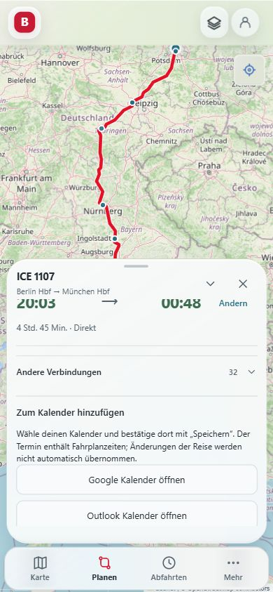

# V56: Reiseplanung und Reiseexport erweitert

Stand: 12. Oktober 2026. Ausgangspunkt: `feat/v56-reliability-ux-audit-20261012`, Commit `d8cd016`. Releasekandidat für V56.0; der tatsächliche Veröffentlichungsstand ist in GitHub und Render zu prüfen.

## Was bereits vorbereitet war

V56 enthält Störungs-/Baustellenmeldungen, teilbare Reiseplanungen, lokale Profil- und Datenexportfunktionen, eine neue Installationsansicht und ein Changelog. Zuverlässigkeitskorrekturen betreffen Timeouts, abgebrochene Anfragen, Verspätungsfilter, Gleis-Fallbacks und veraltete Echtzeitdaten. Die V55.1-Korrekturen sind bereits integriert.

Die Code-Review-Diagnose von PR #60 zeigte am Ausgangscommit einen fehlgeschlagenen Quality-Check: Nach Desktop-/Mobile-Wechsel lag die Bahnhofssuche über dem Kartenbutton. Beide Build-Checks bestanden. Dies ist ein konkreter Freigabehinderungsgrund; erfolgreiche Builds allein belegen keine funktionierende mobile Oberfläche.

## Neu ergänzt

- Reisealternativen nach frühester Ankunft, kürzester Dauer, wenigsten Umstiegen oder geringstem Fußweg sortieren. Die Empfehlung der Quelle bleibt als eigene Option erhalten. Bei eigener Sortierung stehen ausgefallene Verbindungen hinten.
- Fußwegminuten und Unterschied zur Dauer der gewählten Reise direkt vergleichen. Abfahrtsdatum anzeigen, damit Fahrten am Folgetag nicht wie bereits vergangene Fahrten aussehen.
- Einen Tag früher oder später suchen, bei gleicher lokaler Uhrzeit; auch über Zeitumstellung, Monats- und Jahreswechsel.
- Reiseoptionen zurücksetzen, ohne Start, Ziel und Datum erneut einzugeben.
- Eine gewählte Reise als ICS-Kalenderdatei herunterladen. Kalenderzeiten stammen aus dem Fahrplan, Prognosen stehen ausdrücklich nur in der Beschreibung. Ausgefallene Reisen sind gesperrt.
- Auf Wunsch des Nutzers Textdownload und Kopieren entfernt. Google Kalender und Outlook öffnen einen vorausgefüllten Termin; ICS bleibt für andere Kalender. Der Termin muss im Kalender gespeichert werden. Ohne autorisierten Kalenderzugriff kann die Website eine Speicherung weder durchführen noch bestätigen. Die ICS-Beschreibung enthält weiterhin alle Reiseabschnitte als gekennzeichnete Momentaufnahme.
- Offline-Hinweis in Planung und Reiseansicht mit Hinweis auf möglicherweise veraltete Daten. Dieser Hinweis beschreibt den Browser-Netzstatus; Online bedeutet nicht automatisch, dass alle Datenanbieter erreichbar sind.
- Platz für beide Headerbuttons in der mobilen Bahnhofssuche reservieren. Bei geringer Höhe gewinnt das Ausblenden der Header-Suche auch gegen die spezielleren Bahnhofsstile.

## Prüfung

- TypeScript ohne Fehler; ESLint ohne Fehler. Eine bereits vorhandene Warnung betrifft das Profilbild (`next/no-img-element`).
- Produktionsbuild erfolgreich. Der Build warnt weiterhin vor großen JavaScript-Chunks; eine weitere Aufteilung bleibt sinnvoll.
- Automatisierte Regressionen für V56 und Produktoberflächen bestanden. Neuer Reise-Audit prüft Sortierungen ohne Mutation, Tageswechsel einschließlich Zeitumstellung, Kalenderzeiten, Ausfälle, ungültige Zeitspannen, Escaping und die UTF-8-Zeilenlänge von ICS-Dateien. Der Audit ist im Quality-Workflow eingebunden.
- Live-Suche Berlin Hbf → München Hbf im lokalen Browser erfolgreich. Alternative Reisen nach Dauer sortiert; Tageswechsel und Filterrücksetzung über sichtbare Bedienelemente geprüft.
- Kalenderbutton erzeugte eine reale Datei mit `DTSTART:20261012T164300Z`, `DTEND:20261012T213900Z` und Berlin Hbf → München Hbf. Der Browser meldete die erfolgreiche Erstellung.
- Mobile 390 × 844 und 358 × 844 CSS-Pixel, Querformat 844 × 390 und Desktop 1365 × 900 geprüft. Keine horizontale Seitenüberbreite in den geprüften mobilen Zuständen.
- Desktop → Mobile → Abfahrten → Karte reproduzierte die Überdeckung vor der gezielten Korrektur. Danach trifft die Buttonmitte den Kartenbutton, und der Klick öffnet die Kartenoptionen. Im kurzen Querformat ist die störende Header-Suche ausgeblendet.

## Noch zu prüfen und weiterzuentwickeln

Dies ist kein Nachweis für sämtliche Geräte oder App-Zustände. Reale Android-/iOS-Tastaturen, PWA-Installation und Updates sowie Screenreader bleiben im Geräte-QA zu prüfen. Den neuen Offline-Hinweis habe ich hier im Code geprüft; gezielte Offline-Fehler wurden nicht im Browser simuliert. Die Kalenderlinks sind einschließlich Zeitzonenwechsel, Eingabe-Escaping, Ausfällen und Fahrplanzeiten automatisiert geprüft. Der Testbrowser besitzt keinen angemeldeten Kalenderaccount; tatsächliches Speichern in einem persönlichen Kalender ist dadurch nicht belegt.

Der folgende Quality-Lauf kam über den zuvor verdeckten Kartenbutton hinaus. Er scheiterte an einer veralteten Testauswahl: Nach Einführung des App-Reiters prüfte der Test Plus im dritten statt vierten Reiter. Der Test wählt jetzt den explizit gekennzeichneten Plus-Reiter; die Aussage „noch nicht buchbar“ bleibt unverändert geprüft.

Google dokumentiert die verwendeten vorausgefüllten Termine unter https://developers.google.com/workspace/calendar/api/concepts/inviting-attendees-to-events#provide_a_link_for_users_to_add_the_event.

Als nächstes sind ein vollständiger grüner Quality-Lauf, Rückkehr aus dem Hintergrund, Wiederaufnahme nach Netzwechsel und Messungen auf schwächeren Mobilgeräten wichtig. Erst danach passen größere Funktionen wie dauerhafte Reisebegleitung, verlässliche Benachrichtigungen oder Kontosynchronisierung. Diese benötigen einen belastbaren Backend- und Berechtigungsentwurf.

Der nächste vollständige CI-Lauf bestand die Mobile-, Einstellungs-, Stations- und Kartenprüfungen und fand im Planner-Test bei 360 Pixeln mit großer Schrift abgeschnittene Abfahrt-/Ankunftsbuttons. Die Zeitwahl wird jetzt unter 470 Pixeln und bei großer Schrift in einer eigenen Zeile angeordnet. Im Browser sind beide Buttons bei 360 × 740, 358 × 569 und Desktop 1365 × 900 vollständig lesbar; der mobile Suchbutton bleibt erreichbar. Der Planner-Test bleibt unverändert und prüft die Korrektur im folgenden CI-Lauf.
